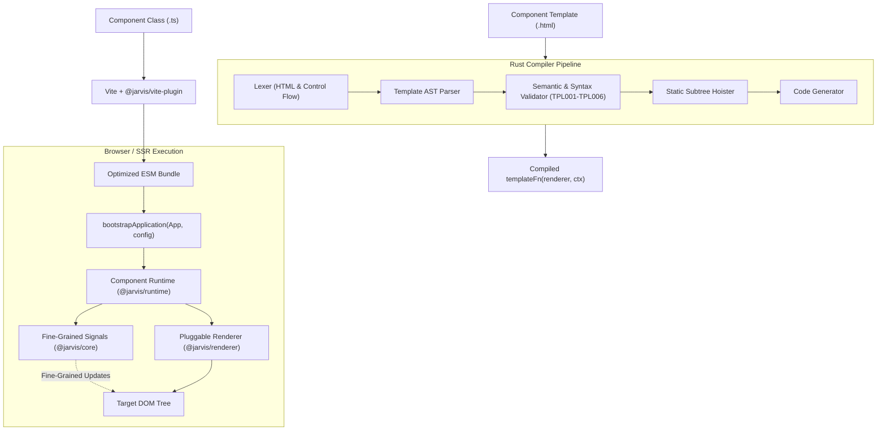

# Jarvis Framework Architecture

Jarvis is a high-performance, Angular-inspired frontend framework built with a native Rust template compiler, fine-grained reactive signals (zero RxJS), standalone component architecture, and a pluggable renderer abstraction.

---

## Architectural Pillars

### 1. Fine-Grained Reactive Signals (`@jarvis/core` / `@jarvis/reactive`)
- **Primitive Signals**: `signal(initialValue)` holds mutable state with precise dependency tracking.
- **Derived Computations**: `computed(() => fn())` derives values lazily with automatic memoization.
- **Side Effects**: `effect(() => fn())` runs reactive side-effects batched through a microtask scheduler.
- **Glitch-Free & Scoped**: Diamonds update glitch-free; all computations and effects are bound to ownership scopes and cleaned up automatically upon component destruction.
- **Strictly Zero RxJS**: No Observable overhead, no manual unsubscriptions, no memory leaks.

### 2. Native Rust Compiler (`crates/jarvis-compiler`, `jarvis-napi`)
- Compiles `.html` templates at build time into optimized JavaScript functions.
- Static subtrees are emitted as hoisted template strings and cloned via `cloneNode(true)`.
- Dynamic nodes (interpolations, property bindings, event handlers, control flow) are wired with direct signal effects.
- Runs in-process via NAPI-RS or persistent daemon worker mode with SHA-256 caching for sub-3ms recompilation.

### 3. Component Runtime (`@jarvis/runtime`)
- Manages component instantiation, dependency injection, and lifecycle hooks (`onInit`, `afterRender`, `onDestroy`).
- Standalone components only: `@Component({ selector, templateUrl, styleUrl })`. No `NgModule` ceremony.
- Mounts and reconciles components using keyed reconciliation algorithms.

### 4. Pluggable Renderer Abstraction (`@jarvis/renderer`)
- Decouples DOM operations from framework logic.
- Implementations:
  - `DOMRenderer`: High-speed browser DOM manipulation with automatic HTML sanitization.
  - `SSRRenderer`: Fast server-side string rendering with HTML entity escaping and script sanitization.
  - `TestRenderer`: In-memory virtual DOM for fast headless unit testing.

---

## Compilation & Execution Pipeline



---

## Detailed Data & Update Flow

```
[User Action / API Event]
         │
         ▼
  signal.set(value)
         │
         ▼
  [Jarvis Reactive Scheduler]
         │  (Batched microtask, Glitch-free DAG)
         ▼
  computed() Re-evaluates Lazily
         │
         ▼
  effect() Triggered for Active View
         │
         ▼
  renderer.setTextContent() / setAttribute()
         │  (Direct Node Access, Zero VDOM Diff Overhead)
         ▼
      [Target DOM]
```

---

## Security Model
- All interpolations `{{ ... }}` are escaped by default through the renderer sanitization layer.
- Potentially dangerous URL schemes (`javascript:`, `vbscript:`, `data:text/html`) are neutralized.
- Raw HTML injection strictly requires explicit `bypassSecurityTrustHtml` tokens.
